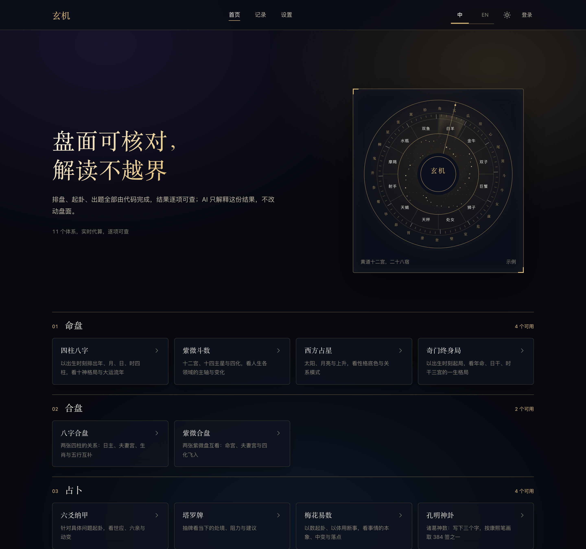
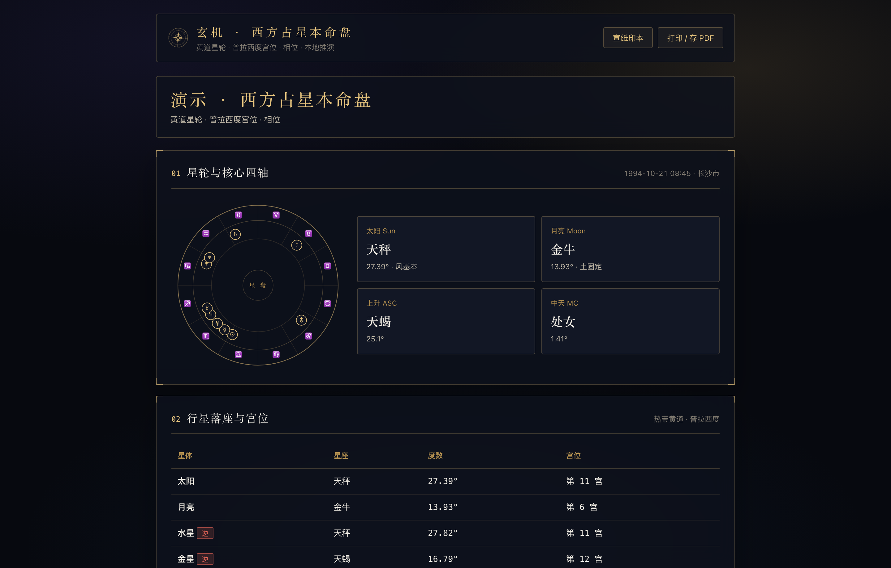
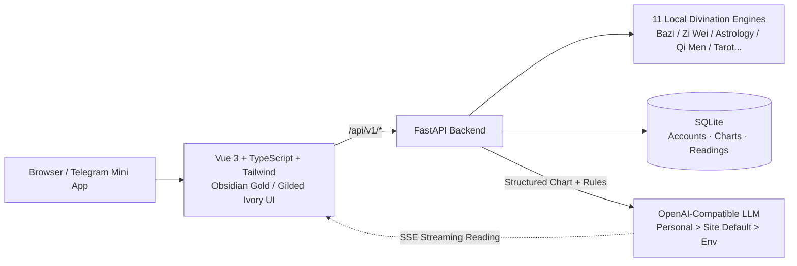

<div align="center">

<h1>✦ Xuanji · 玄机 ✦</h1>

<p><strong>Verifiable Charts, Grounded Readings — A Multi-System Divination & AI Workbench</strong></p>

<p>
  <a href="README.md">简体中文</a> &nbsp;·&nbsp;
  <a href="README.en.md"><b>English</b></a>
</p>

<p>
  
  
  
  
  
</p>

<p>
  <a href="#-ui-showcase">Showcase</a> &nbsp;•&nbsp;
  <a href="#-11-divination-systems">Systems</a> &nbsp;•&nbsp;
  <a href="#-highlights">Highlights</a> &nbsp;•&nbsp;
  <a href="#-quick-start">Quick Start</a> &nbsp;•&nbsp;
  <a href="#-ai-configuration">AI Setup</a> &nbsp;•&nbsp;
  <a href="#-offline-skill-mode">Offline CLI</a>
</p>

<br />



</div>

---

> **Code computes the charts; AI interprets them.**  
> No more black-box LLM fortune-telling that hallucinates planetary positions or pillars. Xuanji runs deterministic astronomical, lunar, and classical algorithms locally to produce **structured, verifiable chart data**, then hands those exact facts to your LLM for grounded streaming readings.

---

## ✨ UI Showcase

### 🌓 Dual-Theme Astrolabe Workbench: Obsidian Gold (Default) & Gilded Ivory (Light)

| Obsidian Gold · Dark Astrolabe (Default) | Gilded Ivory · Light Editorial |
| :---: | :---: |
|  |  |

### 📊 Live Chart & AI Reading Workbench


### 📜 Standalone Offline HTML Charts (`skills/xuanji-suanming`)

| Zi Wei Dou Shu · Dual-Column Interactive Chart | Western Astrology · SVG Natal Wheel |
| :---: | :---: |
|  |  |

---

## 🧭 11 Divination Systems

All 11 systems are computed locally by deterministic engines across Eastern metaphysics, Western astrology, synastry, divination, and personality profiling:

| Category | System | Key Capabilities & Outputs |
| :--- | :--- | :--- |
| **Natal (4)** | **Four Pillars (Bazi)** | True solar time, solar-term pillars, Ten Gods, hidden stems, Luck Pillars, annual cycles & Shen Sha |
| | **Zi Wei Dou Shu** | Traditional 4×4 12-palace grid, 14 major stars, brightness schools, natal/annual Four Transformations, interactive Trine & Opposite highlighting, pattern detection |
| | **Western Astrology** | Tropical zodiac, Placidus houses, Sun/Moon/ASC/MC, planetary aspects, element/modality balance & SVG natal wheel |
| | **Qi Men Dun Jia** | Chaibu rotating plate, Luoshu 3×3 Nine Palaces (Doors, Stars, Deities, Stems), lifelong Year/Day/Hour anchors |
| **Synastry (2)** | **Bazi Synastry** | Side-by-side Four Pillars comparison, Day Master & Spouse Palace harmony/clash breakdown with reference score |
| | **Zi Wei Synastry** | Cross-palace resonance between Life & Spouse palaces, star interactions & reference score |
| **Oracle (4)** | **Liu Yao (I Ching)** | Coin / Time / Number casting, SVG hexagrams, original/nuclear/changed hexagrams, Six Relatives & Six Spirits |
| | **Meihua Yishu** | Time / Number casting, Ti-Yong Five Elements interaction & three-stage hexagram progression |
| | **Tarot** | Classic spreads, Major & Minor Arcana upright/reversed cards & keywords |
| | **Kongming Oracle** | 3-character Kangxi stroke calculation mapping to the 384 traditional lots & poems |
| **Profile (1)** | **MBTI** | 32-item four-dimension spectrum, strengths, blind spots & ideal roles |

---

## ⚡ Highlights

<table>
  <tr>
    <td width="50%" valign="top">
      <h4>🎯 Global Birthplace & True Solar Time</h4>
      Built-in Chinese cities + 41 major international cities (searchable by English aliases like <code>Tokyo</code> / <code>New York</code>), plus manual longitude/latitude & UTC offset. True solar time applies standard meridian (<code>UTC × 15°</code>) + longitude offset + equation of time uniformly.
    </td>
    <td width="50%" valign="top">
      <h4>🤖 Streaming AI Readings · Auto-Saved</h4>
      Multi-select reading topics with one-click Select All / Clear. Readings auto-save to your account or browser <code>localStorage</code> and restore on revisit. English questions receive English answers automatically.
    </td>
  </tr>
  <tr>
    <td width="50%" valign="top">
      <h4>🔑 Bring Your Own OpenAI-Compatible LLM</h4>
      Works with DeepSeek, OpenAI, Ollama, or any custom gateway. Every user (even guests) can set their own API key in the browser; admins can configure a site-wide default. Chart calculation works fully without an LLM.
    </td>
    <td width="50%" valign="top">
      <h4>🛡️ Per-Account Isolation & Guest Mode</h4>
      The first registered user becomes admin. Logged-in users get isolated SQLite history (up to 50 records). Guests can use all 11 systems and AI readings with zero server upload (stored strictly in <code>localStorage</code>).
    </td>
  </tr>
  <tr>
    <td width="50%" valign="top">
      <h4>🌗 Obsidian Gold / Gilded Ivory Dual Themes</h4>
      Responsive across desktop, tablet, and mobile. Defaults to the Obsidian Gold astrolabe theme with one-click switching to Gilded Ivory light mode, bilingual ZH/EN UI, and native <b>Telegram Mini App</b> safe-area support.
    </td>
    <td width="50%" valign="top">
      <h4>📦 Standalone Offline Agent Skill</h4>
      <code>skills/xuanji-suanming</code> runs completely standalone with zero external network calls, generating printable, interactive single-file HTML charts + JSON + Markdown for all 11 systems.
    </td>
  </tr>
</table>

### 🏗 Architecture



---

## 🚀 Quick Start

### One-Command Dev Launch (Recommended)

```bash
# Starts both backend and frontend (auto-installs uv / npm deps; Ctrl-C stops both)
bash scripts/dev.sh
```

- **Frontend**: http://127.0.0.1:5173
- **Backend API Docs**: http://127.0.0.1:8000/docs
- **Custom Ports**: `SM_BE_PORT=8010 SM_FE_PORT=5183 bash scripts/dev.sh`

<details>
<summary><b>Manual Two-Terminal Setup (click to expand)</b></summary>

```bash
# Terminal 1: Backend
cd backend
uv sync
uv run uvicorn app.main:app --reload --port 8000

# Terminal 2: Frontend
cd frontend
npm install
npm run dev
```

</details>

---

## 🤖 AI Configuration

Priority order: **Personal Config > Site Default > Environment Variables** (optional — all charts work without AI).

1. **Personal Config (All users, including guests)**: Open **Settings → AI Reading** and enter your Base URL, Model, and API Key. Saved only in browser `localStorage` (`sm_llm_personal`).
2. **Site Default (Admin)**: The first registered user is admin (or set `SM_ADMIN_USERNAME=<user>` beforehand) and can persist defaults to `backend/.local/llm.json` (`0600`, gitignored).
3. **Environment Variables** (any OpenAI-compatible API):

```bash
SM_LLM_BASE_URL=https://api.deepseek.com
SM_LLM_API_KEY=sk-...
SM_LLM_MODEL=deepseek-chat
```

---

## 📦 Offline Skill Mode

Run `skills/xuanji-suanming` directly from the CLI without starting any server to generate standalone HTML charts, JSON, and Markdown:

```bash
# Zi Wei Dou Shu (dual-column interactive HTML chart + JSON)
sh skills/xuanji-suanming/scripts/paipan.sh --name Demo --gender male \
  --solar 1994-10-21 --time 08:45 --city 九江 --year 2026 --out ./charts

# Any of the other 10 systems (HTML + JSON + Markdown)
sh skills/xuanji-suanming/scripts/paipan.sh --system astrology --name Demo --gender male \
  --solar 1994-10-21 --time 08:45 --city 长沙 --out ./charts
```

---

## 🔧 Advanced Reference

<details>
<summary><b>💾 Data Storage & Security</b></summary>

| Location | Contents | Notes |
| :--- | :--- | :--- |
| `backend/.local/app.db` | Accounts, sessions, charts, AI readings | Dir `0700` / file `0600`; override via `SM_DB_PATH` |
| `sm_session` Cookie | Login session (30 days) | `HttpOnly + SameSite=Lax`, salted `scrypt` passwords, SHA-256 session tokens; set `SM_COOKIE_SECURE=1` for `Secure` |
| `localStorage` | `sm_theme`, `sm_locale`, `sm_birth` | UI theme, language & last birth input |
| `localStorage` | `sm_guest_records`, `sm_guest_readings` | Guest charts & readings (up to 50, browser-only) |
| `localStorage` | `sm_llm_personal` | Personal LLM config & API key (browser-only) |

> Note: Built-in international city timezones use standard fixed offsets without DST. For DST dates, switch to manual coordinates and enter the actual UTC offset.

</details>

<details>
<summary><b>🧪 Automated Tests & E2E Smoke Suite</b></summary>

```bash
# 1. Backend unit tests & linter
cd backend && uv run pytest -q && uv run ruff check app tests

# 2. Isolated E2E smoke test (27 cases using temp DB & ports)
bash scripts/smoke-isolated.sh

# 3. Standalone skill self-test across all 11 systems (77 checks)
sh skills/xuanji-suanming/scripts/selftest.sh
```

</details>

<details>
<summary><b>📱 Telegram Mini App (Quick HTTPS Tunnel)</b></summary>

Prerequisite: frontend (`5173`) and backend (`8000`) are running.

```bash
# Launches a cloudflared HTTPS tunnel and updates the Telegram bot menu button
bash scripts/telegram-miniapp.sh

# Useful options
bash scripts/telegram-miniapp.sh --dry-run    # Start tunnel & print payload only
bash scripts/telegram-miniapp.sh --no-menu    # Start tunnel without updating menu button
```

> Quick Tunnel URLs rotate on restart; for production, use a Cloudflare Named Tunnel or a VPS with HTTPS reverse proxy.

</details>

<details>
<summary><b>📁 Directory Structure</b></summary>

```text
xuanji/
├── backend/                  # FastAPI service & 11 divination engines (SQLite in .local/app.db)
├── frontend/                 # Vue 3 + TypeScript + Tailwind SPA
├── skills/xuanji-suanming/   # Standalone offline 11-system CLI & HTML chart renderer skill
├── scripts/                  # One-command dev runner, E2E smoke tests, Telegram tunnel script
└── docs/                     # Product plan, architecture docs & README screenshots
```

</details>

---

<div align="center">
  <sub>Divination outputs are for cultural learning and self-reflection only, and do not constitute medical, legal, or financial advice.</sub>
</div>
