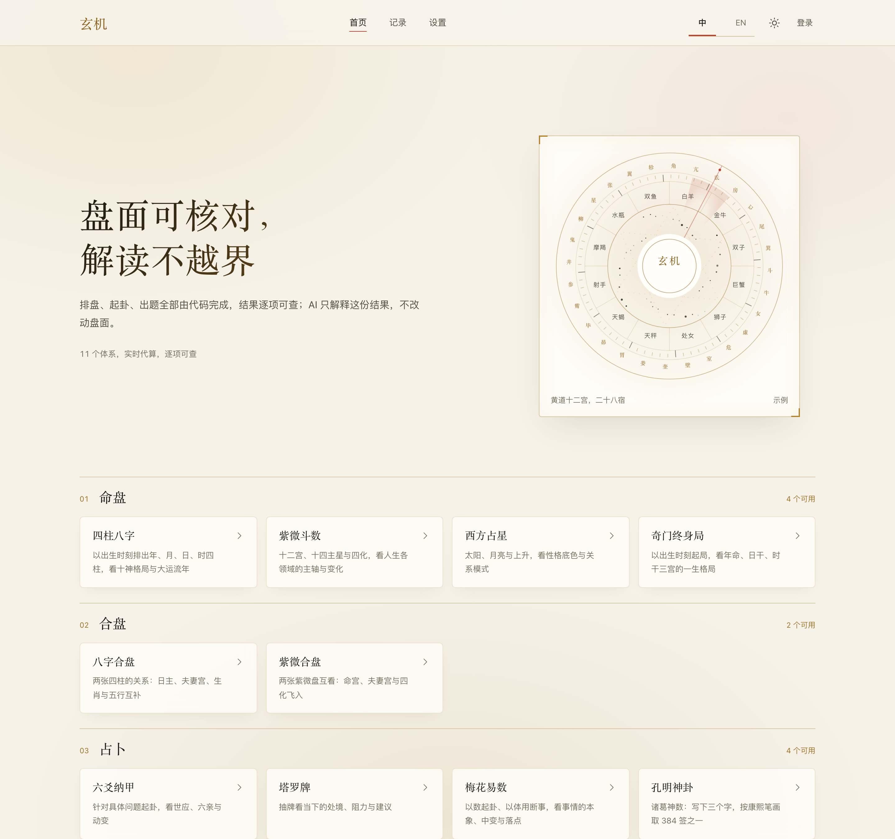
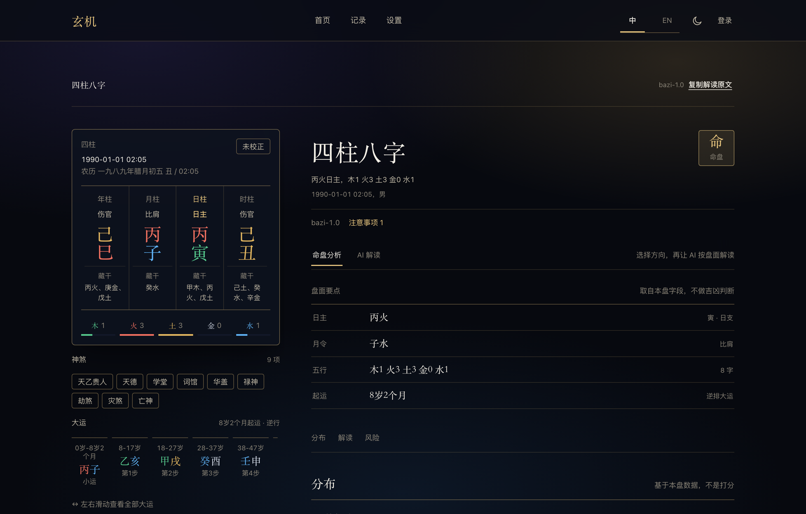
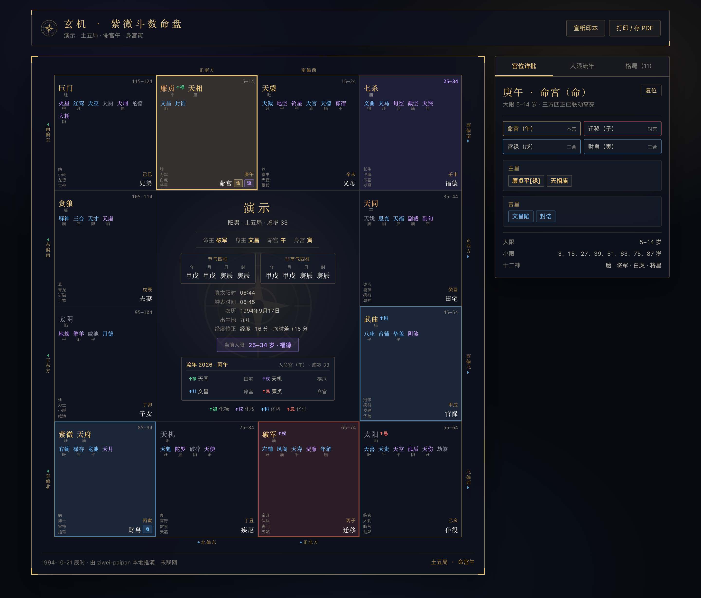

# Xuanji · Multi-System Divination & AI Reading

[中文](README.md) | **English**

An online multi-system divination platform. **Code computes the charts; AI interprets them.**

- **Frontend**: Vue 3 + TypeScript + Vite + Tailwind (**Obsidian Gold** dark astrolabe theme by default, with one-click **Gilded Ivory** light theme; responsive across desktop / tablet / mobile; bilingual ZH/EN)
- **Backend**: Python 3.12/3.13 + FastAPI + [uv](https://docs.astral.sh/uv/)
- **11 Systems**: Four Pillars (Bazi), Zi Wei Dou Shu, Western Astrology, Qi Men Dun Jia (Lifelong), Bazi Synastry, Zi Wei Synastry, Liu Yao, Tarot, Meihua Yishu, Kongming Oracle, MBTI
- **Birthplace & Timezone**: Major Chinese cities + 41 major international cities (with English aliases), plus manual longitude/latitude & UTC offset entry
- **Accounts**: Username + password authentication with per-account isolated history and AI readings; guest users can also configure their own LLM, cast charts, and save records locally in the browser

## UI Showcase

### Homepage · Obsidian Gold (Dark) & Gilded Ivory (Light)

| Obsidian Gold · Dark Astrolabe (Default) | Gilded Ivory · Light Editorial |
| :---: | :---: |
|  |  |

### Live Chart Result Page (Four Pillars / Bazi)



### Standalone Offline HTML Charts (`skills/xuanji-suanming`)

| Zi Wei Dou Shu · Dual-Column Interactive Chart | Western Astrology · SVG Natal Wheel |
| :---: | :---: |
|  |  |

## Key Features

- **Birthplace & True Solar Time**: City search covers domestic and international cities (e.g., `Tokyo`, `New York`, showing country and `UTC` offset). If a city is not listed, switch to manual coordinates (`longitude -180..180`, `latitude -90..90`, `UTC offset -12..14`, default `+8`). True solar time computes the standard meridian (`UTC × 15°`) plus longitude correction and equation of time uniformly across Bazi, Qi Men, and Zi Wei.
- **Streaming AI Readings**: Multi-select reading topics (defaults to overall profile) with one-click **Select All / Clear**. Readings **auto-save** to your account when logged in, or to browser `localStorage` as a guest, and restore automatically when revisiting a record. Prompts enforce conclusion-first plain-language explanations without filler; **English questions receive English answers**, otherwise responses follow the UI language.
- **Bring Your Own LLM**: Any user (including guests) can configure their own OpenAI-compatible base URL, model name, and API key in **Settings → AI Reading** (stored only in browser `localStorage`). Admins can additionally save a site-wide default. Personal settings always take precedence over site defaults.
- **Account & Record Isolation**: Open registration; the first registered user becomes admin. Logged-in users only see their own records (up to 50). Guests can use all 11 systems and AI readings with records stored strictly in browser `localStorage`.
- **Dual Themes & Bilingual UI**: Defaults to **Obsidian Gold** dark theme with one-click switching to **Gilded Ivory** light theme, plus instant Chinese/English toggle persisted in `localStorage`.

## Accounts & Records

- **Auth**: Usernames 3–32 chars (`a-z`, `0-9`, `_`, `.`, `-`), passwords 8–128 chars. Passwords are stored with salted `scrypt`; sessions use an `HttpOnly` + `SameSite=Lax` `sm_session` cookie (30 days), with only the SHA-256 hash stored server-side.
- **Admin**: The first registered account is automatically promoted to admin. To pre-assign an admin username before starting the backend, set `SM_ADMIN_USERNAME=<username>` (case-insensitive).
- **LLM Config API**: `GET/PUT/DELETE /settings/llm` are admin-only (`401` if logged out, `403` if non-admin). `/meta` is public and exposes only configuration status and model/base URL without secrets.
- **Record Isolation**: Logged-in charts save automatically to SQLite (up to 50 per account; cross-account access returns `404`). Guest records and readings stay in browser `localStorage` (up to 50) and never upload to the server.

## Quick Start

```bash
# Start both backend and frontend with one command (Ctrl-C stops both)
bash scripts/dev.sh
# Frontend: http://127.0.0.1:5173    Backend docs: http://127.0.0.1:8000/docs
# Custom ports: SM_BE_PORT=8010 SM_FE_PORT=5183 bash scripts/dev.sh
```

Or run them separately:

```bash
# Backend (Terminal 1)
cd backend
uv sync
uv run uvicorn app.main:app --reload --port 8000

# Frontend (Terminal 2)
cd frontend
npm install
npm run dev
```

## Configure AI Reading (Optional)

Priority order: **Personal Config > Site Default > Environment Variables**.

1. **Personal Config (Everyone, including guests)**: Go to **Settings → AI Reading** and enter your API Base URL, Model, and API Key. Saved locally in `localStorage` (`sm_llm_personal`) and sent per request—never written to the server database.
2. **Site Default (Admin)**: Save the form as the site default (`backend/.local/llm.json`, mode `0600`, gitignored).
3. **Environment Variables** (any OpenAI-compatible provider):

```bash
SM_LLM_BASE_URL=https://api.deepseek.com
SM_LLM_API_KEY=sk-...
SM_LLM_MODEL=deepseek-chat
```

Chart calculation works fully offline without an LLM configured.

## Data Storage

| Location | Contents | Notes |
|---|---|---|
| `backend/.local/app.db` | Accounts, sessions, charts, AI readings | Dir `0700` / file `0600`; override path with `SM_DB_PATH` |
| `sm_session` Cookie | Login session (30 days) | `HttpOnly` + `SameSite=Lax`; set `SM_COOKIE_SECURE=1` for `Secure` |
| `localStorage` | `sm_theme`, `sm_locale`, `sm_birth`, `sm_birth_b` | Local UI & form preferences |
| `localStorage` | `sm_guest_records`, `sm_guest_readings` | Guest charts & AI readings (up to 50, browser-only) |
| `localStorage` | `sm_llm_personal` | Personal LLM config & API key (browser-only) |

> Note: Built-in international city timezones use standard fixed offsets without DST. For DST dates, use manual coordinates and enter the actual UTC offset.

## Testing

```bash
# Backend unit tests & lint
cd backend && uv run pytest -q && uv run ruff check app tests

# Isolated full E2E smoke test (27 cases, temp DB & ports)
bash scripts/smoke-isolated.sh

# Smoke test against running 8000/5173 servers
node scripts/smoke.mjs

# Standalone skill self-test (all 11 systems, 77 checks)
sh skills/xuanji-suanming/scripts/selftest.sh
```

## Telegram Mini App (Temporary HTTPS Tunnel)

Expose your local instance as a Telegram Mini App via Cloudflare Quick Tunnel:

```bash
# Prerequisite: frontend (5173) and backend (8000) are running
bash scripts/telegram-miniapp.sh

# Useful flags
bash scripts/telegram-miniapp.sh --dry-run    # Start tunnel & print payload without calling Telegram
bash scripts/telegram-miniapp.sh --no-menu    # Start tunnel only
```

Quick tunnel URLs change on every restart; for a permanent URL, use a Cloudflare Named Tunnel or a VPS with HTTPS reverse proxy.

## Directory Structure

```
backend/    FastAPI backend & divination engines (SQLite stored in .local/app.db)
frontend/   Vue 3 SPA (Obsidian Gold & Gilded Ivory dual-theme UI)
skills/     Standalone offline multi-system CLI & HTML chart skill (xuanji-suanming)
scripts/    Dev runner (dev.sh), E2E smoke tests, and Telegram Mini App tunnel
docs/       Product plan, architecture docs, and UI screenshots (screenshots/)
```

> Divination outputs are for cultural learning and self-reflection only, and do not constitute medical, legal, or financial advice.
