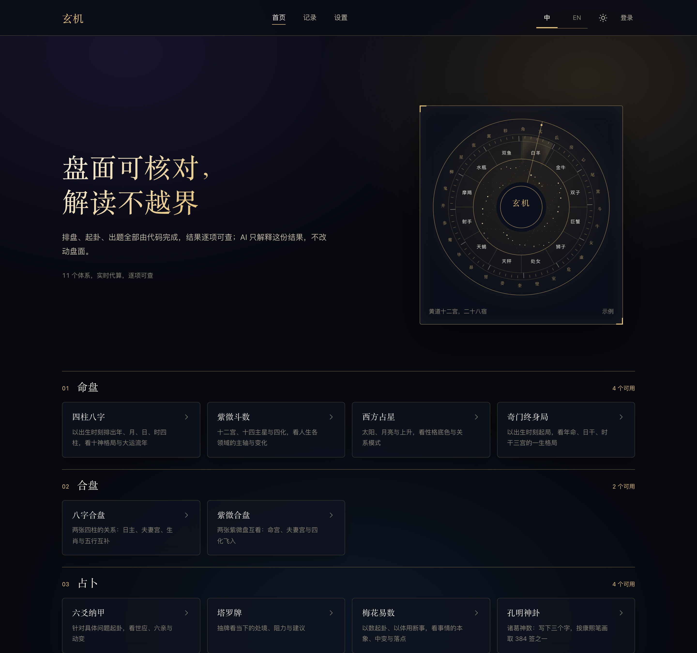
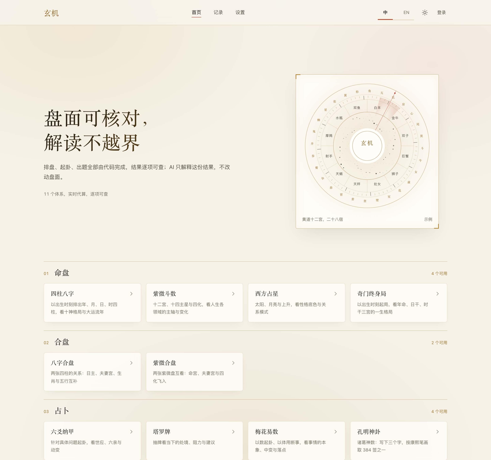
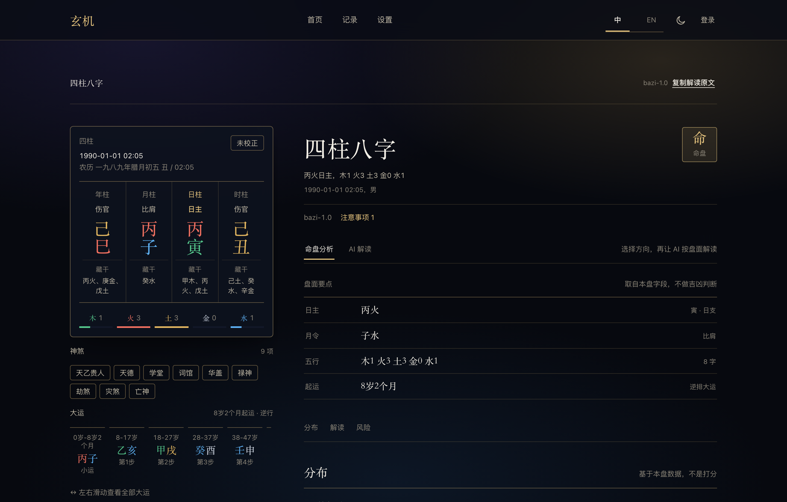
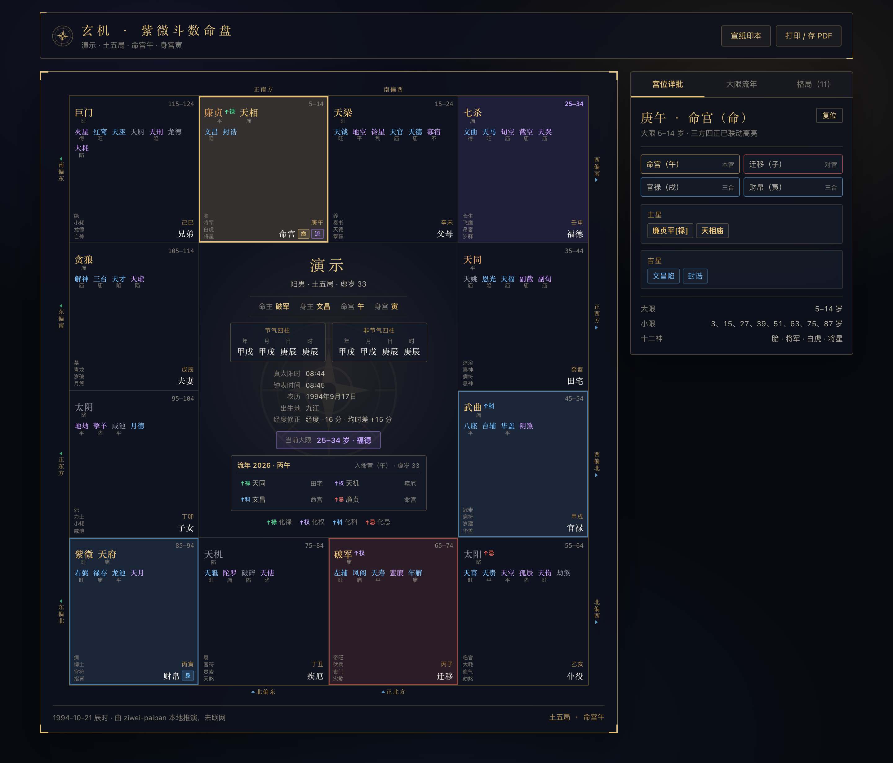
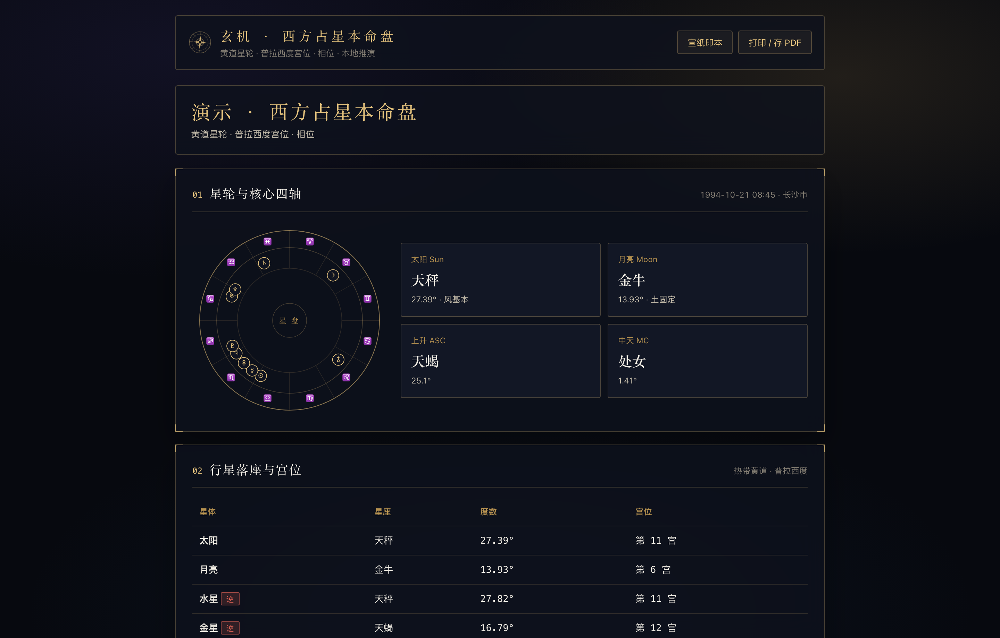
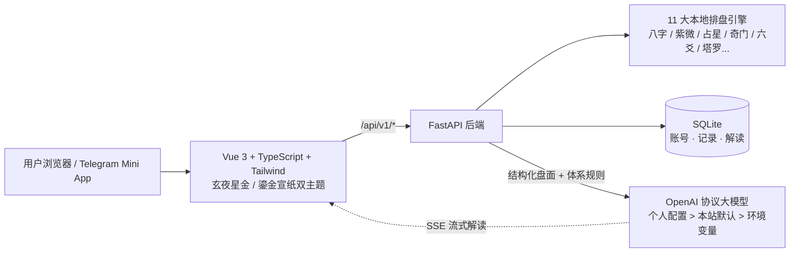

<div align="center">

<h1>✦ 玄机 · Xuanji ✦</h1>

<p><strong>盘面可核对，解读不越界 —— 多体系命理排盘与 AI 解读工作台</strong></p>

<p>
  <a href="README.md"><b>简体中文</b></a> &nbsp;·&nbsp;
  <a href="README.en.md">English</a>
</p>

<p>
  
  
  
  
  
</p>

<p>
  <a href="#-界面预览">界面预览</a> &nbsp;•&nbsp;
  <a href="#-11-大术数体系">支持体系</a> &nbsp;•&nbsp;
  <a href="#-核心亮点">核心亮点</a> &nbsp;•&nbsp;
  <a href="#-快速开始">快速开始</a> &nbsp;•&nbsp;
  <a href="#-ai-解读配置">AI 配置</a> &nbsp;•&nbsp;
  <a href="#-离线技能模式">离线技能</a>
</p>

<br />



</div>

---

> **排盘交给代码，解读交给 AI。**  
> 拒绝「输入生日直接让大模型瞎编星曜」的盲盒式算命。玄机在本地用确定性天文历法与术数引擎算出**逐项可核对的结构化盘面**，再将盘面事实交给大模型按对应体系规则流式解读——**查不到的依据不写，不改动任何盘面数据。**

---

## ✨ 界面预览

### 🌓 双主题星盘工作台：玄夜星金（默认） & 鎏金宣纸（浅色）

| 玄夜星金 · 暗黑星盘风（默认） | 鎏金宣纸 · 雅集星盘风（浅色） |
| :---: | :---: |
|  |  |

### 📊 在线排盘与 AI 解读工作台



### 📜 离线单文件 HTML 命盘（`skills/xuanji-suanming`）

| 紫微斗数 · 双栏交互命盘（三方四正联动） | 西方占星 · SVG 黄道本命星轮 |
| :---: | :---: |
|  |  |

---

## 🧭 11 大术数体系

覆盖传统东方命理、西方占星、合盘关系、即时占卜与性格测试，全部由本地代码引擎实时演算：

| 分组 | 体系 | 核心能力与产出 |
| :--- | :--- | :--- |
| **命盘（4）** | **四柱八字** | 真太阳时校正、节气四柱、十神、藏干、大运流年、神煞 |
| | **紫微斗数** | 传统 4×4 十二宫、十四主星、亮度流派、生年/流年四化、三方四正联动、格局识别 |
| | **西方占星** | 热带黄道、普拉西度宫位、日月升中天四轴、行星相位、元素/模式分布与 SVG 星轮 |
| | **奇门终身局** | 拆补转盘、洛书九宫（八门/九星/八神/天地盘干）、年命/日干/时干三宫用神 |
| **合盘（2）** | **八字合盘** | 双人四柱对比、日主/夫妻宫/生肖冲合互补分析与参考分 |
| | **紫微合盘** | 双人命宫/夫妻宫呼应、星曜互动张力明细与参考分 |
| **占卜（4）** | **六爻纳甲** | 铜钱 / 时间 / 数字起卦，SVG 六爻卦象、本/互/变三卦、六神六亲世应 |
| | **梅花易数** | 时间 / 数字起卦，体用五行生克与本/互/变三卦演变 |
| | **塔罗牌** | 经典牌阵抽牌、大小阿卡纳正逆位牌面与关键词 |
| | **孔明神卦** | 诸葛神数三字笔画取 384 签、卦爻与签诗要点 |
| **性格（1）** | **MBTI 测试** | 32 题四维倾向光谱、优势、盲点与适配方向 |

---

## ⚡ 核心亮点

<table>
  <tr>
    <td width="50%" valign="top">
      <h4>🎯 精准真太阳时与全球出生地</h4>
      内置国内主要城市与 41 个国外主要城市（支持 <code>Tokyo</code> / <code>New York</code> 英文搜索），也可手动填经纬度与 UTC 时区。按当地标准子午线（<code>时区 × 15°</code>）+ 经度差 + 均时差统一校正。
    </td>
    <td width="50%" valign="top">
      <h4>🤖 流式 AI 解读 · 自动存档</h4>
      支持多选解读方向（一键全选/取消）、流式输出，结果自动持久化——登录后存账号，未登录存浏览器。用英文提问自动以英文作答，否则跟随界面语言。
    </td>
  </tr>
  <tr>
    <td width="50%" valign="top">
      <h4>🔑 自由配置任意 OpenAI 协议模型</h4>
      支持 DeepSeek / OpenAI / Ollama / 自建网关。人人可在设置页填自己的 API Key（仅存本机浏览器），管理员可保存「本站默认」兜底，不配模型也能完整排盘。
    </td>
    <td width="50%" valign="top">
      <h4>🛡️ 账号隔离 & 游客即开即用</h4>
      首个注册账号自动成为管理员；登录后记录与解读按账号隔离（SQLite，每账号最多 50 条）。未登录同样可用全部 11 体系与 AI 解读，数据仅留本机 <code>localStorage</code>。
    </td>
  </tr>
  <tr>
    <td width="50%" valign="top">
      <h4>🌗 玄夜星金 / 鎏金宣纸双主题</h4>
      桌面 / 平板 / 手机三档响应式布局，默认玄夜星金暗黑星盘风，右上角一键切换鎏金宣纸浅色与中/英文，并深度适配 <b>Telegram Mini App</b> 安全区。
    </td>
    <td width="50%" valign="top">
      <h4>📦 内置离线 Agent 技能包</h4>
      <code>skills/xuanji-suanming</code> 可脱离前后端服务独立运行，零外部依赖本地排盘，全部 11 个体系均可直接输出可离线浏览与 A4 打印的单文件 HTML + JSON + Markdown。
    </td>
  </tr>
</table>

### 🏗 架构概览



---

## 🚀 快速开始

### 一键启动（推荐）

```bash
# 一条命令同时拉起前后端（自动检查 uv / npm 依赖，Ctrl-C 一键退出）
bash scripts/dev.sh
```

启动后访问：
- **前端界面**：http://127.0.0.1:5173
- **后端 API 文档**：http://127.0.0.1:8000/docs
- **自定义端口**：`SM_BE_PORT=8010 SM_FE_PORT=5183 bash scripts/dev.sh`

<details>
<summary><b>手动分终端启动（点击展开）</b></summary>

```bash
# 终端 1：启动后端
cd backend
uv sync
uv run uvicorn app.main:app --reload --port 8000

# 终端 2：启动前端
cd frontend
npm install
npm run dev
```

</details>

---

## 🤖 AI 解读配置

三档配置优先级：**个人配置 > 本站默认 > 环境变量**（未配置时排盘照常使用）。

1. **个人配置（所有人，含未登录）**：进入 **设置 → AI 解读** 填写 Base URL、Model 与 API Key，仅存当前浏览器 `localStorage`（`sm_llm_personal`），不写入服务端数据库。
2. **本站默认（管理员）**：首个注册账号自动为管理员（或启动前设 `SM_ADMIN_USERNAME=<用户名>`），可将配置保存至 `backend/.local/llm.json`（权限 `0600`，已 gitignore）。
3. **环境变量**（兼容任何 OpenAI 协议服务）：

```bash
SM_LLM_BASE_URL=https://api.deepseek.com
SM_LLM_API_KEY=sk-...
SM_LLM_MODEL=deepseek-chat
```

---

## 📦 离线技能模式

`skills/xuanji-suanming` 是一套可独立运行的多体系本地排盘技能，无需启动前后端即可产出单文件 HTML 命盘、JSON 与 Markdown：

```bash
# 紫微斗数（生成双栏交互 HTML 命盘 + JSON）
sh skills/xuanji-suanming/scripts/paipan.sh --name 张三 --gender male \
  --solar 1994-10-21 --time 08:45 --city 九江 --year 2026 --out ./charts

# 四柱八字 / 西方占星 / 奇门 / 六爻 / 塔罗等其余 10 个体系（生成 HTML + JSON + MD）
sh skills/xuanji-suanming/scripts/paipan.sh --system astrology --name 张三 --gender male \
  --solar 1994-10-21 --time 08:45 --city 长沙 --out ./charts
```

---

## 🔧 进阶说明

<details>
<summary><b>💾 数据存储与账号安全</b></summary>

| 位置 | 存储内容 | 说明 |
| :--- | :--- | :--- |
| `backend/.local/app.db` | 账号、会话、排盘记录、AI 解读 | 目录 `0700` / 文件 `0600`；可用 `SM_DB_PATH` 换路径；备份此文件即备份全部服务端数据 |
| `sm_session` Cookie | 登录会话（30 天） | `HttpOnly + SameSite=Lax`，密码采用 scrypt 加盐，服务端仅存 token 的 SHA-256；`SM_COOKIE_SECURE=1` 开启 `Secure` |
| `localStorage` | `sm_theme` / `sm_locale` / `sm_birth` | 主题、语言与上次填写的生辰 |
| `localStorage` | `sm_guest_records` / `sm_guest_readings` | 未登录时的排盘记录与解读（最多 50 条，不上传） |
| `localStorage` | `sm_llm_personal` | 个人模型配置（含 API Key，仅存本机浏览器） |

> 注：国外城市内置时区为标准固定偏移（不含夏令时 DST）；若出生日期处于夏令时，请切至「手动输入坐标」并填入当时的实际 UTC 偏移。

</details>

<details>
<summary><b>🧪 自动化测试与端到端冒烟</b></summary>

```bash
# 1. 后端单元测试与代码检查
cd backend && uv run pytest -q && uv run ruff check app tests

# 2. 全量隔离端到端冒烟（27 条用例：临时库 + 临时端口，跑完自动清理）
bash scripts/smoke-isolated.sh

# 3. 离线技能 11 体系自检（77 项校验）
sh skills/xuanji-suanming/scripts/selftest.sh
```

</details>

<details>
<summary><b>📱 Telegram Mini App（一键临时公网隧道）</b></summary>

前置条件：`5173` 前端与 `8000` 后端已启动。

```bash
# 自动通过 cloudflared 拉起 HTTPS 隧道，并同步更新 Telegram 机器人菜单按钮
bash scripts/telegram-miniapp.sh

# 常用选项
bash scripts/telegram-miniapp.sh --dry-run    # 仅起隧道并打印配置，不调 Telegram API
bash scripts/telegram-miniapp.sh --no-menu    # 仅起隧道，不动菜单按钮
```

> Quick Tunnel 地址每次重启都会变化，生产环境建议使用 Cloudflare Named Tunnel 或自有域名 HTTPS 反代。

</details>

<details>
<summary><b>📁 项目目录结构</b></summary>

```text
xuanji/
├── backend/                  # FastAPI 服务与 11 大排盘引擎（SQLite 存 .local/app.db）
├── frontend/                 # Vue 3 + TypeScript + Tailwind 单页应用
├── skills/xuanji-suanming/   # 可独立运行的 11 体系本地排盘与 HTML 渲染技能包
├── scripts/                  # 一键启动（dev.sh）、E2E 冒烟测试、Telegram 隧道脚本
└── docs/                     # 产品计划、架构契约与 README 高清截图（screenshots/）
```

</details>

---

<div align="center">
  <sub>命理内容属于传统文化学习与自我观察参考，不构成医疗、法律或投资建议。</sub>
</div>
